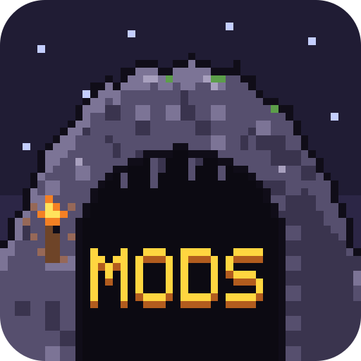

<div align="center">
	<h1>CaveMods</h1>
	
	<br/><br/>
	A Linux mod manager for games the official tools leave behind.
	<br/><br/>
	<a href="https://github.com/ScoobyDouche/CaveMods/releases/latest"></a>
	<a href="LICENSE.md"></a>
</div>

CaveMods is a fork of the [Nexus Mods App](https://github.com/Nexus-Mods/NexusMods.App) built for Linux. It adds games the official app doesn't support and handles the things that make modding on Linux painful: case-sensitive file names, native Linux ports with odd folder layouts, and Windows games running through Proton.

Download mods from Nexus Mods with one click, turn them on and off, and CaveMods puts the files where the game expects them.

## Supported games

| Game | Store | Build | What CaveMods manages |
|---|---|---|---|
| Star Wars: Knights of the Old Republic | Steam, GOG | Windows (Proton) | `Override/` and `modules/*.mod` |
| Star Wars: Knights of the Old Republic II | Steam | Native Linux (Aspyr) | `steamassets/override/` and `steamassets/modules/*.mod`, file names lower-cased so the Linux port finds them |
| Kingdom Hearts III + Re Mind | Steam | Windows (Proton) | `.pak` mods in `Content/Paks/~mods` |
| Kingdom Hearts 0.2 Birth by Sleep | Steam (HD 2.8 collection) | Windows (Proton) | `.pak` mods in `Content/Paks/~mods` |
| Fallout 3 (incl. GOTY) | Steam | Windows (Proton) | `Data/` files, FOMOD installers, FOSE, `plugins.txt` and timestamp load order |
| Fallout: New Vegas | Steam | Windows (Proton) | `Data/` files, FOMOD installers, xNVSE, `plugins.txt` and timestamp load order |

The games the Nexus Mods App already supports (Stardew Valley, Cyberpunk 2077, Baldur's Gate 3, Mount & Blade II: Bannerlord, Skyrim Special Edition and Fallout 4) are still included.

CaveMods only ever touches the mod folders listed above and never changes the contents of the game's own files.

Fallout 3 and New Vegas load plugins oldest-file-first rather than in `plugins.txt` order, so for those two games CaveMods sets the modification dates of the plugin files (including the official DLC `.esm` files) to apply the load order. Only the dates change.

### Not supported

- **TSLPatcher / HoloPatcher mods for KotOR.** They edit game files instead of adding new ones. Install them with HoloPatcher.
- **Mods distributed as `.exe` installers.** CaveMods can only unpack zip, 7z and rar archives.
- **Kingdom Hearts 1.5+2.5 ReMIX and Dream Drop Distance.** Their mods need OpenKH Mods Manager.
- **UE4SS / LogicMods mods for Kingdom Hearts III.**

## Install

1. Download `CaveMods-<version>-x86_64.AppImage` from the [latest release](https://github.com/ScoobyDouche/CaveMods/releases/latest).
2. Make it executable: `chmod +x CaveMods-*-x86_64.AppImage`
3. Run it, and log in with your Nexus Mods account to download mods.

CaveMods finds games installed through Steam, including extra Steam library folders on other drives.

## Building from source

You need the [.NET 9 SDK](https://dotnet.microsoft.com/download/dotnet/9.0).

```bash
git clone --recurse-submodules https://github.com/ScoobyDouche/CaveMods.git
cd CaveMods
dotnet run --project src/NexusMods.App/NexusMods.App.csproj
```

## Reporting problems

Open an [issue](https://github.com/ScoobyDouche/CaveMods/issues), or use the **Send Issue** button in the app. Logs are in `~/.local/state/CaveMods/Logs`.

## Credits and license

CaveMods is based on the [Nexus Mods App](https://github.com/Nexus-Mods/NexusMods.App) by Nexus Mods and its contributors. It is an unofficial fork and is not affiliated with or endorsed by Nexus Mods.

Licensed under the [GNU General Public License v3.0](LICENSE.md).
